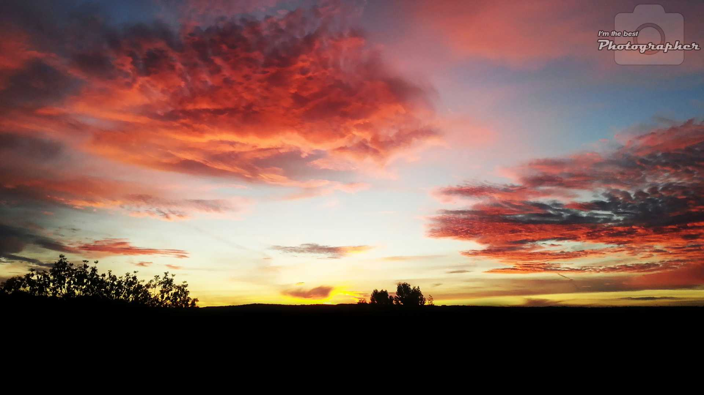

[](https://github.com/gexo/php-image-editor/actions/workflows/ci.yml)
[](https://packagist.org/packages/gexo/php-image-editor)
[](https://packagist.org/packages/gexo/php-image-editor)
[](https://github.com/gexo/php-image-editor/blob/master/LICENSE)

# PHP Image Editor

PHP library to easily edit image with GD extension. Resize, crop, merge, draw, and many more options !

## About this fork

This is a fork of [DantSu/php-image-editor](https://github.com/DantSu/php-image-editor) by Franck Alary.
It keeps the original API and the `DantSu\PHPImageEditor` namespace, and focuses on compatibility with current PHP versions
(no deprecations, warnings or notices on PHP 8.1 - 8.5).

The package declares `replace: dantsu/php-image-editor`, so it can be used as a drop-in replacement:
packages that depend on `dantsu/php-image-editor` will use this fork instead of installing the original as well.

## Requirements

- PHP 8.1 or newer
- Extensions: `gd`, `curl`, `mbstring`

## Installation

Install this library easily with composer :

```cmd
composer require gexo/php-image-editor
```

## How to use

### Example 1

Create a empty image, draw on it and display it :

```php
use \DantSu\PHPImageEditor\Image;

\header('Content-type: image/png');

$image = Image::newCanvas(500, 500)
    ->drawRectangle(0, 0, 500, 500, '#444')
    ->drawRectangle(0, 350, 500, 500, '#FF8800')
    ->writeText('I got the power !', __DIR__ . '/resources/font.ttf', 40, '#FFFFFF', Image::ALIGN_CENTER, 310)
    ->drawCircle(25, 100, 100, '#FF8800')
    ->drawCircle(25, 100, 95, '#000000FF')
    ->drawCircle(475, 100, 100, '#FF8800')
    ->drawCircle(475, 100, 95, '#000000FF');

for($i = 0; $i <= 360; $i+=30) {
    $image
        ->drawArrowWithAngle(250, 200, $i, 80, 2, '#FF8800')
        ->drawArrowWithAngle(250, 200, ($i + 15), 50, 2, '#FF8800');
}

$image
    ->crop(450, 300, Image::ALIGN_CENTER, Image::ALIGN_MIDDLE)
    ->displayPNG();
```


### Example 2

Apply a watermark on a photo and save it :

```php
use \DantSu\PHPImageEditor\Image;

Image::fromPath(__DIR__ . '/resources/photo.jpg')
    ->downscaleAndCrop(1920, 1080, Image::ALIGN_CENTER, Image::ALIGN_BOTTOM)
    ->pasteOn(
        Image::fromPath(__DIR__ . '/resources/watermark.png')->downscaleProportion(300, 300),
        Image::ALIGN_RIGHT,
        Image::ALIGN_TOP
    )
    ->saveJPG(__DIR__ . '/my-image.jpg', 70);
```



## Documentation

See [DantSu\PHPImageEditor\Image](./docs/classes/DantSu/PHPImageEditor/Image.md) documentation class for more details.

## Contributing

Please fork this repository and contribute back using pull requests.

Run the test suite with `composer test`. The tests fail on any PHP deprecation, warning or notice.

Any contributions, large or small, major features, bug fixes, are welcomed and appreciated but will be thoroughly reviewed.

